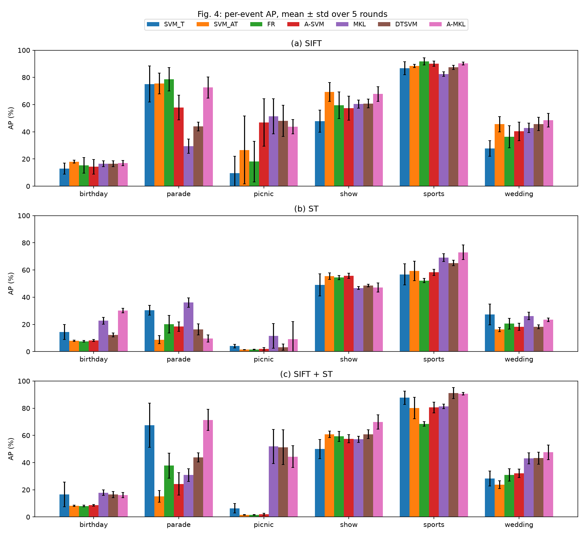
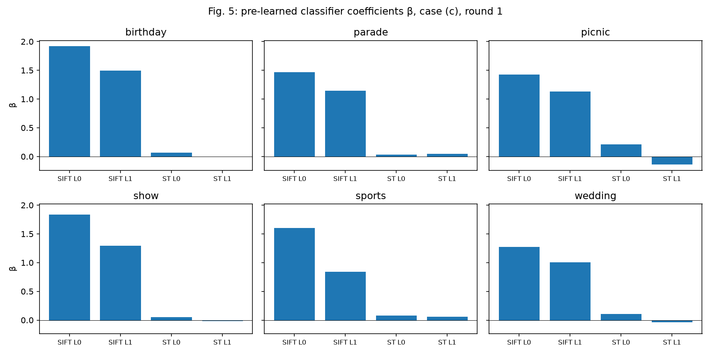
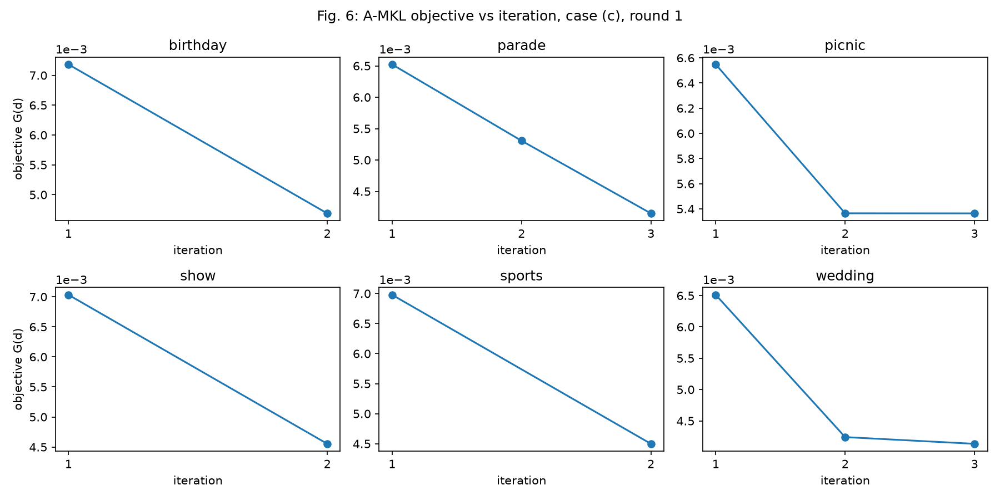
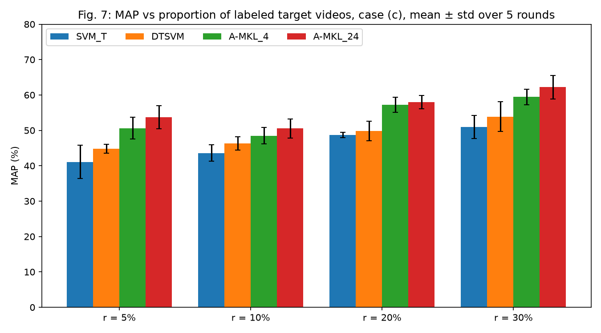
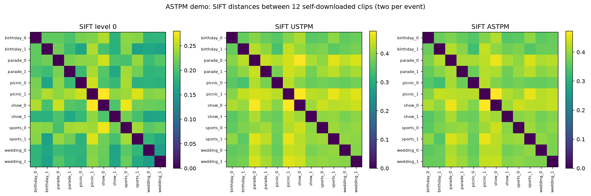

# Visual event recognition with A-MKL: a from-scratch reproduction

This repository reproduces the learning experiments of

> L. Duan, D. Xu, I. W. Tsang and J. Luo, **"Visual Event Recognition in Videos by Learning from Web Data"**, *IEEE Transactions on Pattern Analysis and Machine Intelligence*, 34(9):1667–1680, 2012. doi:[10.1109/TPAMI.2011.265](https://doi.org/10.1109/TPAMI.2011.265) (conference version: CVPR 2010).

The authors' code is no longer available. Everything here was written from the paper alone.

## The paper in short

The task is to recognize six events (birthday, parade, picnic, show, sports, wedding) in **consumer videos** (the *target domain*: 195 Kodak videos) when only 3 labeled consumer videos per event are available. Many loosely labeled **YouTube videos** (the *auxiliary domain*: 906 videos found by keyword search) help, but they look different from consumer videos. The paper makes two contributions:

1. **ASTPM (Aligned Space-Time Pyramid Matching).** A video-to-video distance. Each video is split into space-time volumes at two pyramid levels (level 0 is the whole video; level 1 is 2×2×2 volumes). At level 1 each volume is matched one-to-one to its best partner in the other video instead of to the volume at the same position (USTPM, the unaligned baseline). Volumes are compared with EMD over image blocks (SIFT) or χ² over word histograms (HOG+HOF descriptors at STIP space-time interest points, "ST"; the archive's files call them STIP).
2. **A-MKL (Adaptive Multiple Kernel Learning).** A target classifier f(x) = Σ_m d_m w_mᵀφ_m(x) + Σ_p β_p f_p(x) + b. It combines many base kernels (4 kernel types × 5 bandwidths × each feature and level) with *pre-learned classifiers* f_p (SVMs averaged over the base kernels of one feature and level). The kernel weights d are learned to minimize both the structural risk and the domain mismatch between YouTube and consumer videos, measured by MMD. Training alternates an SVM solve with a closed-form update of d.

The paper compares A-MKL with SVM_T, SVM_AT, FR, A-SVM, MKL and DTSVM. A-MKL comes out best in every feature setting.

## Scope

| Part of the paper | Reproduced here? |
|---|---|
| Tables 1–2: level 0 and aligned level 1 (ASTPM) rows | Yes (`experiments/tables_1_2.py`) |
| Tables 1–2: unaligned level 1 (USTPM) rows | **No.** The archive has only ASTPM level-1 distances |
| Table 3: seven methods × three feature cases | Yes (`experiments/table_3.py`) |
| Table 4: A-MKL_4 vs A-MKL_24 | Yes (`experiments/table_4.py`) |
| Fig. 4: per-event AP | Yes (`experiments/fig_4.py`) |
| Figs. 5–6: β and A-MKL convergence | Yes (`experiments/figs_5_6.py`) |
| Fig. 7: MAP vs proportion of labeled consumer videos | Yes (`experiments/fig_7.py`) |
| ASTPM on the paper's videos | **No.** The videos and features are not available. A from-scratch ASTPM module is shown on 12 self-downloaded clips instead (`experiments/astpm_demo.py`) |

## What is reused and what is original

**Reused (not my work):** the authors' archived data release: the ASTPM distance matrices `dist_{SIFT,STIP}_L{0,1}.mat` for all 1101 videos (195 consumer + 906 YouTube), `labels.mat`, and the five training/test rounds in `TRAINING_IND/`. These are the inputs to every experiment in Tables 1–4 and Figs. 4–7. They are not included in this repository.

**Original (written from scratch for this project):** all code in `src/ver/` and `experiments/`, specifically:

- data loading and verification of the label column order (`data.py`);
- the four kernel types, the bandwidth grid and feature replication (`kernels.py`);
- SVM training on precomputed kernels and the pre-learned classifier (`svm.py`, built on scikit-learn's `SVC`);
- SVM_T, SVM_AT, FR, A-SVM, MKL, DTSVM and A-MKL behind one interface (`methods.py`), and the A-MKL solver of Algorithm 1 with simplex projection and line search (`amkl.py`);
- AP/MAP evaluation (`evaluate.py`);
- the ASTPM / USTPM matching module (`astpm.py`), with EMD from the POT library;
- every experiment, figure script and test.

The authors' MATLAB code and third-party ports were not read or used. Libraries: NumPy, SciPy, scikit-learn, POT, OpenCV, matplotlib, yt-dlp (all from PyPI).

## Setup and running

Requires [uv](https://docs.astral.sh/uv/) and Python 3.12.

```bash
git clone https://github.com/diarisheIT/visual-event-recognition-amkl.git
cd visual-event-recognition-amkl
uv sync
```

Create `data/raw/` (it is gitignored), place the authors' archive `distance_matrix.zip` in it, and unzip it there. The code expects:

```
data/raw/distance_matrix/
├── dist_SIFT_L0.mat  dist_SIFT_L1.mat  dist_STIP_L0.mat  dist_STIP_L1.mat
├── labels.mat
└── TRAINING_IND/
```

Then run each experiment from the repository root. Each one prints ours-vs-paper and writes its results to `results/`:

```bash
uv run pytest                                # tests: data checks, method behaviour, ASTPM properties
uv run python experiments/tables_1_2.py      # results/tables_1_2.json
uv run python experiments/table_3.py         # results/table_3.json (per-event AP included)
uv run python experiments/fig_4.py           # results/fig_4.png, drawn from table_3.json
uv run python experiments/figs_5_6.py        # results/figs_5_6.json, fig_5.png, fig_6.png
uv run python experiments/table_4.py         # results/table_4.json
uv run python experiments/fig_7.py           # results/fig_7.json, fig_7.png
uv run python experiments/astpm_demo.py      # downloads 12 clips to data/astpm_demo/; results/astpm_demo.{json,png}
```

`fig_7.py --plot-only` and `astpm_demo.py --plot-only` redraw the figure from the saved JSON. Every experiment runs on a laptop CPU. The split proportions of Fig. 7 are seeded. The demo clips are whatever YouTube search returns at download time, so the demo is the one result that may change if rerun.

All results below are MAP (%) as mean ± std over the paper's five rounds (Fig. 7: five seeded rounds per proportion). C = 1 for all SVMs; A-MKL uses θ = 1e-5, λ = 20, ε = 1e-5, τ = 1e-5, T_max = 15. Base kernels use bandwidths 2^l·γ0 with l ∈ {−3, …, 1}.

## Results: ours vs paper

### Tables 1 and 2: SVM_AT with the default bandwidth

**Table 1: SIFT**

| | Gaussian | Laplacian | ISD | ID |
|---|---|---|---|---|
| Level 0, ours | 49.44 ± 3.04 | 53.53 ± 1.29 | 53.40 ± 3.50 | 52.01 ± 3.00 |
| Level 0, paper | 41.4 ± 3.7 | 44.2 ± 3.8 | 45.0 ± 3.5 | 46.2 ± 4.0 |
| Level 1 ASTPM, ours | 42.05 ± 3.57 | 45.46 ± 3.82 | 46.39 ± 3.83 | 48.04 ± 4.11 |
| Level 1 ASTPM, paper | 50.4 ± 3.7 | 53.8 ± 1.8 | 52.9 ± 3.6 | 51.0 ± 2.5 |
| Level 1 USTPM, paper | 43.0 ± 2.7 | 47.7 ± 1.7 | 49.0 ± 1.6 | 48.2 ± 1.5 |

**Table 2: ST**

| | Gaussian | Laplacian | ISD | ID |
|---|---|---|---|---|
| Level 0, ours | 20.65 ± 0.71 | 35.51 ± 1.50 | 22.52 ± 1.02 | 35.64 ± 1.57 |
| Level 0, paper | 22.2 ± 1.8 | 36.1 ± 0.8 | 22.0 ± 3.8 | 35.6 ± 0.7 |
| Level 1 ASTPM, ours | 21.66 ± 1.30 | 36.32 ± 0.82 | 21.83 ± 3.35 | 35.66 ± 0.67 |
| Level 1 ASTPM, paper | 20.6 ± 0.7 | 35.8 ± 1.7 | 22.3 ± 1.1 | 35.9 ± 1.8 |
| Level 1 USTPM, paper | 20.1 ± 1.0 | 33.9 ± 0.6 | 21.8 ± 0.7 | 33.4 ± 0.7 |

ST matches the paper within 1.6 points in every cell, including the gap between squared-distance kernels (Gaussian, ISD ≈ 21) and plain-distance kernels (Laplacian, ID ≈ 36). For SIFT, our level 0 matches the paper's level 1 and our level 1 matches the paper's level 0 (see [Discussion](#discussion)).

### Table 3: all methods, three feature cases

(a) SIFT, (b) ST, (c) SIFT + ST.

| Case | | SVM_T | SVM_AT | FR | A-SVM | MKL | DTSVM | A-MKL |
|---|---|---|---|---|---|---|---|---|
| (a) | ours | 43.30 ± 5.66 | 53.94 ± 5.07 | 49.93 ± 5.00 | 51.12 ± 4.55 | 47.16 ± 2.34 | 50.42 ± 2.22 | **56.65 ± 2.15** |
| | paper | 42.32 ± 5.50 | 53.93 ± 5.58 | 49.98 ± 5.63 | 38.42 ± 7.93 | 47.19 ± 2.59 | 52.36 ± 1.88 | **57.14 ± 2.34** |
| (b) | ours | 30.31 ± 2.75 | 24.88 ± 2.05 | 26.06 ± 1.44 | 26.79 ± 0.97 | **35.38 ± 1.38** | 27.27 ± 1.16 | 32.08 ± 2.36 |
| | paper | 32.56 ± 2.08 | 24.73 ± 2.22 | 28.44 ± 2.61 | 24.95 ± 1.25 | 35.34 ± 1.55 | 31.07 ± 2.60 | **37.24 ± 1.58** |
| (c) | ours | 42.72 ± 5.35 | 31.60 ± 2.27 | 34.31 ± 2.20 | 34.20 ± 2.17 | 47.04 ± 2.27 | 51.14 ± 1.57 | **56.66 ± 1.71** |
| | paper | 42.00 ± 4.94 | 36.23 ± 3.37 | 44.11 ± 3.57 | 32.40 ± 4.99 | 46.92 ± 2.53 | 53.78 ± 2.99 | **58.20 ± 1.87** |

Reproduced: A-MKL is best in cases (a) and (c), within 1.6 points of the paper. Going from (a) to (c), the equal-weight fusions (SVM_AT, FR, A-SVM) get worse and the learned fusions (DTSVM, A-MKL) hold or improve. In case (b), SVM_T beats SVM_AT: YouTube data hurts with ST features alone. SVM_T, SVM_AT and MKL in cases (a) and (b) are within about 2 points of the paper.

Not reproduced: in case (b), A-MKL (32.08) is 5 points below the paper and below MKL. A-SVM in case (a) is 13 points above the paper. FR in case (c) is 10 points below.

### Fig. 4: per-event AP



The per-event pattern matches the paper: sports is easiest (A-MKL 90.29 in case (a)), parade and show come next, and birthday and wedding are hard. Parade in case (c): DTSVM 43.87 → A-MKL 71.31 (paper 65.96 → 75.21). Picnic is the unstable event, with stds up to 24.94 (SVM_AT, case (a)). When ST features are used (cases (b) and (c)), SVM_AT, FR and A-SVM collapse on picnic to 1.45–2.03.

### Fig. 5: β of the four pre-learned classifiers (case (c), round 1)



| Event | SIFT L0 | SIFT L1 | ST L0 | ST L1 |
|---|---|---|---|---|
| birthday | 1.92 | 1.49 | 0.06 | −0.01 |
| parade | 1.47 | 1.14 | 0.03 | 0.05 |
| picnic | 1.42 | 1.13 | 0.21 | −0.14 |
| show | 1.83 | 1.29 | 0.05 | −0.02 |
| sports | 1.60 | 0.84 | 0.08 | 0.06 |
| wedding | 1.28 | 1.01 | 0.11 | −0.03 |

As in the paper, the SIFT classifiers dominate and the ST classifiers get β near (but not exactly) zero. Two differences: the paper's β values are ~18–40, about λ = 20 times ours; and the paper has β(SIFT L1) > β(SIFT L0) for every event while we have the reverse.

### Fig. 6: A-MKL objective per iteration (case (c), round 1)



The objective decreases monotonically from 6.5–7.2 × 10⁻³ to 4.1–5.4 × 10⁻³, the same magnitude as the paper's ~5–7 × 10⁻³. It stops after 2–3 iterations, while the paper's curves flatten after ~6–8 (see [Discussion](#discussion)).

### Table 4: A-MKL_4 vs A-MKL_24 (case (c))

A-MKL_4 uses the event's own 4 pre-learned classifiers; A-MKL_24 uses all 24 from the six events. H is the bandwidth set of the pre-learned classifiers.

| | H = {−3..1} | H = {−4..1} | H = {−5..1} | H = {−6..1} |
|---|---|---|---|---|
| A-MKL_4, ours | 56.66 ± 1.71 | 56.41 ± 2.75 | 56.39 ± 3.15 | 56.22 ± 3.71 |
| A-MKL_4, paper | 58.20 ± 1.87 | 58.33 ± 2.33 | 58.56 ± 2.53 | 57.16 ± 3.02 |
| A-MKL_24, ours | 58.09 ± 2.47 | 58.46 ± 2.65 | **58.66 ± 2.60** | 58.57 ± 2.44 |
| A-MKL_24, paper | 58.74 ± 3.30 | 59.04 ± 3.53 | 59.25 ± 3.73 | **59.28 ± 2.57** |

A-MKL_24 beats A-MKL_4 for every H, by 1.43–2.35 points (paper: 0.54–2.12). Our A-MKL_4 with H = {−3..1} is the same run as Table 3 (c), and the numbers agree exactly.

### Fig. 7: MAP vs proportion r of labeled consumer videos (case (c))



| r | SVM_T ours / paper | DTSVM ours / paper | A-MKL_4 ours / paper | A-MKL_24 ours / paper |
|---|---|---|---|---|
| 5% | 41.10 / ~39 | 44.80 / ~48 | 50.62 / ~51 | 53.72 / ~53 |
| 10% | 43.60 / ~44 | 46.31 / ~49 | 48.49 / ~51.5 | 50.54 / ~53.5 |
| 20% | 48.74 / ~48 | 49.83 / ~60 | 57.22 / ~61 | 58.01 / ~61.5 |
| 30% | 50.95 / ~52.5 | 53.90 / ~59.5 | 59.44 / ~60.5 | 62.21 / ~62 |

As in the paper, A-MKL_4 uses H = {−3..1} and A-MKL_24 uses H = {−6..1}. Paper values are read from its chart (±1 point). The ordering SVM_T < DTSVM < A-MKL_4 < A-MKL_24 holds at every r, as in the paper. SVM_T and A-MKL_24 stay within 3.5 points of the paper. DTSVM is 6–10 points low at 20–30%, the same DTSVM weakness seen in Table 3 (c). Our splits are seeded random draws with at least one labeled video per event, not the authors' splits.

### ASTPM demo on self-downloaded clips



The archive only provides finished distance matrices, so the matching method itself is implemented separately in `src/ver/astpm.py`. The demo downloads two short YouTube clips per event, extracts SIFT at 2 fps over the first 30 s, builds a 100-word vocabulary, and computes level-0, USTPM and ASTPM distances between all 12 clips. On these clips the ASTPM distance is at most the USTPM distance for every pair, as alignment guarantees. The mean off-diagonal distance is 0.3947 for ASTPM and 0.4050 for USTPM. Nearest neighbours rarely share the event (2 of 12 at level 0, none at level 1). Twelve clips with a 100-word vocabulary are a check that the module runs end to end on real video, not a recognition experiment. STIP features are not included because the STIP tool only runs on Linux.

## Discussion

**SIFT level swap.** In Table 1 our SIFT level-0 results match the paper's level-1 (ASTPM) row and our level-1 results match its level-0 row, within about 2 points per kernel. Fig. 5 gives a second, independent signal: the paper has β(SIFT L1) > β(SIFT L0) for every event, and we get the reverse for every event. ST shows no such swap. The most likely explanation is that the archive's `dist_SIFT_L0.mat` and `dist_SIFT_L1.mat` are swapped relative to the paper (or the paper's Table 1 rows are). We use the files as labeled and report the swap rather than correct it. It does not affect Tables 3–4 or Figs. 4, 6 and 7, which use both levels together.

**Missing USTPM rows.** The archive contains only aligned (ASTPM) level-1 distances, so the USTPM rows of Tables 1–2, which are the paper's evidence that alignment helps, cannot be reproduced on the paper's data. The ASTPM demo shows the aligned-vs-unaligned computation on new clips, but at a scale too small to measure recognition accuracy.

**A-MKL stops early, as the paper's update is written.** Algorithm 1 projects d_new = θ(hhᵀ + εI)⁻¹q onto the simplex with a Euclidean projection. hhᵀ + εI is badly conditioned (curvature ≈ ‖h‖² along h, ε = 1e-5 elsewhere), so the projection lands on an arbitrary vertex of the simplex, and d_new − d is often an ascent direction. The line search then finds no step that lowers the objective, and the solver stops after 2–3 iterations instead of ~6–8 (Fig. 6). In a side experiment (not part of this repository's code or `results/`), we replaced the projection with an exact minimisation of the same model over the simplex. It ran more iterations and reached a lower objective, but MAP got worse in all three cases, most of all in case (c). The update as published is kept because it is the algorithm in the paper and its MAP and objective values are closer to the paper's, which suggests the authors' code behaves the same way. The early stop acts as a regulariser: minimising the objective properly favours kernels with low domain mismatch over discriminative ones.

**θ dominance.** With θ = 1e-5, the domain mismatch term ½(hᵀd)² outweighs the θ-scaled structural risk, so the kernel weights mostly follow MMD. This is visible in DTSVM, which often puts all its weight on a single SIFT base kernel: adding the ST kernels in case (c) then changes nothing, and DTSVM (c) equals DTSVM (a) exactly on birthday, parade and show. It probably also explains why DTSVM is our weakest learned method relative to the paper (Table 3 (c), Fig. 7).

**Transductive setting.** MMD is computed between all YouTube videos and all consumer videos, including the unlabeled test videos, as in the paper. A-MKL, DTSVM and MKL therefore see the test inputs (not their labels) during training. The baselines SVM_T, SVM_AT, FR and A-SVM do not.

**Pre-learned classifiers reuse the labeled target videos.** The pre-learned classifiers are trained on YouTube videos plus the same 18 labeled consumer videos that A-MKL is then trained on, so their outputs on those videos are optimistic. We follow the paper here.

**A-MKL_24's gain is within one standard deviation.** In both the paper and our run, A-MKL_24 beats A-MKL_4 for every H, but by less than the round-to-round std (ours: +1.43 to +2.35 against stds of 1.71–3.71). The ranking repeats consistently, but five rounds are not enough to call the gain significant.

**Picnic is unstable.** Picnic has only 6 consumer videos, so after 3 labeled training videos only 3 remain for testing in each round. One misranked video changes its AP by tens of points, which is why picnic carries the largest stds (up to 24.94) and can swing the MAP by several points. Birthday has low AP but is stable (std ≤ 9.2).

**Other gaps.** A-SVM in case (a) is 13 points above the paper and FR in case (c) is 10 points below. A-SVM's perturbation solver and FR's kernel are described only briefly in the paper, so our versions are reasonable readings rather than certain matches. A-MKL in case (b) is 5 points below the paper and below MKL. With ST features alone the pre-learned classifiers are weak (SVM_AT 24.88), so the β term adds noise instead of a useful prior.

**β scale.** We compute β = (1/λ) Σ_i α_i y_i f_p(x_i) from the paper's closed form. The paper's Fig. 5 values are about λ = 20 times ours, which suggests the figure omits the 1/λ factor. The relative pattern (SIFT ≫ ST ≈ 0) matches.

## Acknowledgements

- Lixin Duan, Dong Xu, Ivor W. Tsang and Jiebo Luo for the paper and for archiving the distance matrices, labels and training/test splits that every experiment here starts from.
- The Kodak consumer video benchmark (Loui et al., 2007) for the consumer videos underlying the archive, and YouTube for the web videos.
- The maintainers of NumPy, SciPy, scikit-learn (whose `SVC` wraps LIBSVM), POT (Python Optimal Transport), OpenCV, matplotlib, yt-dlp and uv.
